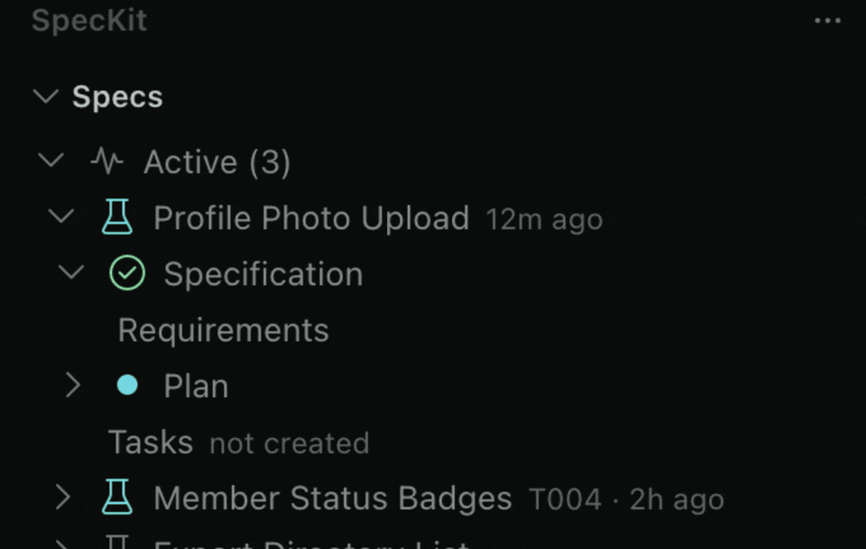
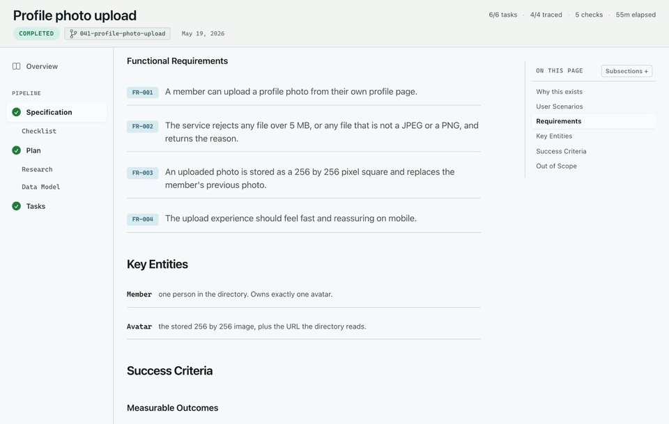
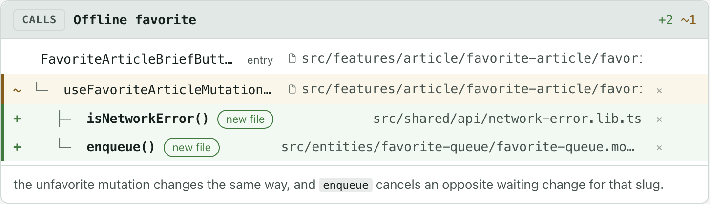
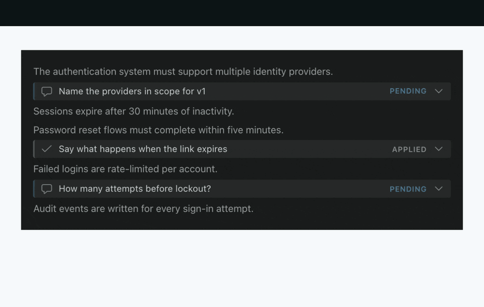
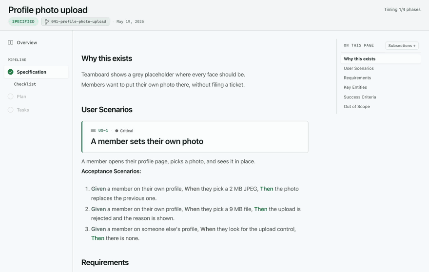
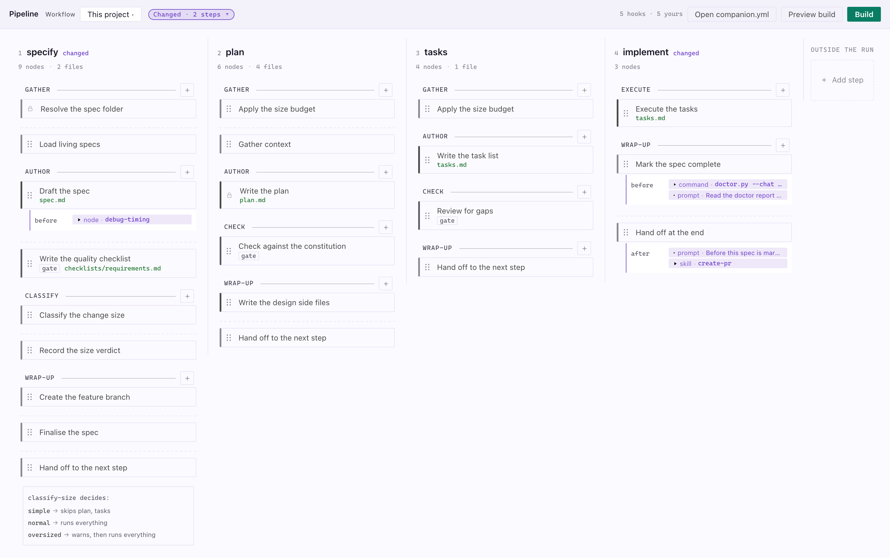

# SpecKit Companion


SpecKit Companion is a VS Code extension for developers who build with an AI assistant and [Spec Kit](https://github.com/github/spec-kit). It lists every spec in your project, opens each one as a page you can read and comment on, follows a run while it happens, and keeps a record of what the AI did and why. Your specs stay plain markdown in your repo, with the run record in a file beside each one, so nothing passes through a server of ours.


## Install

Search for **SpecKit Companion** in the Extensions view, or run:

```bash
code --install-extension alfredoperez.speckit-companion
```

It's on Open VSX too.

### The Spec Kit extension (optional)

This second install runs inside Spec Kit and records each run, which is what the Overview above, the Resume button and living specs are built from. Add it from your project root:

```bash
specify extension add companion --from https://github.com/alfredoperez/speckit-companion/releases/download/companion-latest/companion.zip --force
```

That command needs a Spec Kit CLI that has extensions. The [install page](https://speckit-companion.dev/docs/install) has the full walkthrough and what to do when a step fails.

## First run

1. Open your project folder in VS Code.
2. Click the SpecKit icon in the activity bar.
3. Pick your AI assistant when it asks.
4. Click `+` in the Specs view, or run **SpecKit: New Spec** from the command palette, and describe what you want built.

The [Quickstart](https://speckit-companion.dev/docs/start/your-first-spec) follows one spec from there to done.

## What you get

- **A sidebar for every spec.** Specs are grouped by where they stand, with the status of each document and the assistant each one was last sent to. [Viewer and sidebar](https://speckit-companion.dev/docs/navigate/viewer-and-sidebar)

  

- **Specs you can read.** Requirements are labeled rows, acceptance scenarios read as Given, When, Then, and tasks sit under their phases.

  

- **A plan that draws itself.** Call paths, a lifecycle, a screen and annotated code each draw as a card in the plan. [Plan blocks](https://speckit-companion.dev/docs/steps/plan-blocks)

  

- **Review comments on any line.** Comment on a spec the way you review a pull request, then click **Refine** and your assistant edits the spec from your comments. [Review with comments](https://speckit-companion.dev/docs/steps/review-with-comments)

  

- **A run you can watch.** One button always offers the next step, tasks tick over while implement runs, and the finished run opens on its Overview. [The steps](https://speckit-companion.dev/docs/steps) and [the Overview](https://speckit-companion.dev/docs/results/the-overview)

  

- **A pipeline you can change.** The Workflow Builder draws the steps your project runs and lets you attach your own work before or after any of them. [Workflow Builder](https://speckit-companion.dev/docs/customize/workflow-builder)

  

Also in the extension: [living specs](https://speckit-companion.dev/docs/results/living-specs) that stay current per capability, panes for [bugs and ideas](https://speckit-companion.dev/docs/ide/bugs-and-ideas), and [custom workflows](https://speckit-companion.dev/docs/customize/your-own-workflow).

## Supported assistants

Companion sends each step to the assistant you choose: a CLI in a terminal, such as Claude Code, Gemini CLI, GitHub Copilot CLI or Codex CLI, or the chat panel of your editor. The full list is under [Settings](https://speckit-companion.dev/docs/reference/configuration#providers).

<!-- other-products:start -->
## SpecKit Companion runs in four places

| Where | What it is | Start here |
|---|---|---|
| VS Code | The extension: a sidebar, a spec viewer and the Overview of every run. | [Install](https://speckit-companion.dev/docs/install) |
| Spec Kit | The engine half: records each step so every surface can show progress and resume. | [Install](https://speckit-companion.dev/docs/install) |
| GitHub Copilot app | A live spec board in the app's side panel. | [Copilot app](https://speckit-companion.dev/docs/copilot-app) |
| Claude Code | The followed spec's run above your prompt and in a pane. | [Claude Code](https://speckit-companion.dev/docs/claude-code) |
<!-- other-products:end -->

## Docs

The docs live at [speckit-companion.dev/docs](https://speckit-companion.dev/docs), with [commands](https://speckit-companion.dev/docs/reference/commands) and [settings](https://speckit-companion.dev/docs/reference/configuration) in the reference. In this repo: [Contributing](CONTRIBUTING.md) and the [Changelog](./CHANGELOG.md).

## Telemetry

The extension sends anonymous usage telemetry, never prompt content, paths or names, and sends nothing when `speckit.telemetry` or VS Code's own telemetry setting is off. Details: [Telemetry](https://speckit-companion.dev/docs/reference/configuration#telemetry).

## Support and credits

SpecKit Companion is free and open source. If it saves you time, you can support it through [GitHub Sponsors](https://github.com/sponsors/alfredoperez). It started from [kiro-for-cc](https://github.com/notdp/kiro-for-cc).

## License

[MIT](./LICENSE)
